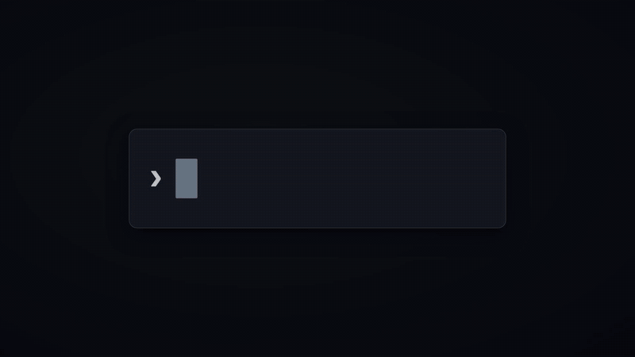

# ASPIRE: Agentic /Skills Discovery for Robotics

[Project Page](https://research.nvidia.com/labs/gear/aspire/) &ensp;|&ensp; [Paper](https://arxiv.org/abs/2607.00272)



ASPIRE is a new type of continual learning: "training" is skill refinement instead of gradient descent. 

"Trained model" is a repo of sensorimotor skills instead of floating weights. 

“Distributed training” is a panel of agents each practicing a different skill instead of sharded minibatches.

## News

- **[2026-10] ASPIRE v1.0 is out!** ASPIRE can now solve a Rubik's Cube, and it achieves 99% success on 80 LIBERO-Pro Goal / Object / Spatial / Long tasks and selected Robosuite, BEHAVIOR-1K tasks.

- **[2026-06] ASPIRE is out!** We achieve SOTA results on LIBERO-Pro, Robosuite, and BEHAVIOR-1K with Claude Opus 4.6! Also check out our table bussing sim-to-real demos!

## Real-World Results

<table>
  <tr>
    <th width="50%">Cross-embodiment sim-to-real</th>
    <th width="50%">Online real-world learning</th>
  </tr>
  <tr>
    <td><video src="https://github.com/user-attachments/assets/ce86d1c1-582e-4388-9eb8-2b9027252eec" width="100%" controls></video></td>
    <td><video src="https://github.com/user-attachments/assets/7fa4ea5c-bcae-4eb8-b0e6-3109af08c94d" width="100%" controls></video></td>
  </tr>
  <tr>
    <td><a href="https://github.com/NVlabs/ASPIRE/blob/v0.1/aspire/real/README.md">Long Horizon Table Bussing</a><br>Claude Opus 4.6 (sim), GPT-5.5 (real)</td>
    <td><a href="https://github.com/NVlabs/ASPIRE/blob/main/docs/system2.md#solve-a-rubiks-cube">Rubik's Cube</a><br>GPT-6 Astra</td>
  </tr>
</table>

<table>
  <tr>
    <td width="33%"><video src="https://github.com/user-attachments/assets/15e5946f-b26d-466e-aa44-c971e5756933" width="100%" controls></video></td>
    <td width="33%"><video src="https://github.com/user-attachments/assets/620eb33d-b9da-40cb-8d84-eb487f264585" width="100%" controls></video></td>
    <td width="33%"><video src="https://github.com/user-attachments/assets/18a8484f-a0bd-4574-9891-f5c49d906bc5" width="100%" controls></video></td>
  </tr>
  <tr>
    <td><a href="https://github.com/NVlabs/ASPIRE/blob/main/docs/system2.md#inverted-cup-nesting">Stack Cups</a><br>GPT-6 Astra</td>
    <td><a href="https://github.com/NVlabs/ASPIRE/blob/main/docs/system2.md#unscrew-and-pour">Unscrew Bottle Cap</a><br>GPT-6 Astra</td>
    <td><a href="https://github.com/NVlabs/ASPIRE/blob/main/docs/system2.md#pill-insertion-and-bottle-closure">Pill in Bottle</a><br>GPT-6 Astra</td>
  </tr>
</table>

## Model Scaling

<table>
  <tr>
    <th width="50%">Success vs. API cost</th>
    <th width="50%">LIBERO-Pro, Robosuite, BEHAVIOR-1K</th>
  </tr>
  <tr>
    <td></td>
    <td></td>
  </tr>
  <tr>
    <th colspan="2">Stronger models discover better strategies</th>
  </tr>
  <tr>
    <td><video src="https://github.com/user-attachments/assets/f4b77674-2ada-4f10-a3de-8126d9512342" width="100%" controls></video></td>
    <td><video src="https://github.com/user-attachments/assets/9645e221-7f6c-4c6d-99b2-dce515afbf6e" width="100%" controls></video></td>
  </tr>
  <tr>
    <td><b>Book under a shelf</b><br>Opus 5.5 and Astra let go of the book and push it under the low shelf.</td>
    <td><b>Push a plate</b><br>Opus 5.5 clears the clutter first; Astra lifts the plate over it.</td>
  </tr>
  <tr>
    <td><video src="https://github.com/user-attachments/assets/d66e195f-93f8-403d-ab47-e098cba2f58b" width="100%" controls></video></td>
    <td><video src="https://github.com/user-attachments/assets/9c795d80-761a-48b4-838e-d20bcd905fd5" width="100%" controls></video></td>
  </tr>
  <tr>
    <td><b>Open the bottom drawer</b><br>Opus 5.5 and Astra tilt the gripper and hook the low handle, as the human does.</td>
    <td><b>Mug in the microwave</b><br>Opus 5.5 and Astra grasp the handle and slide the mug in upright.</td>
  </tr>
</table>

ASPIRE improves with the underlying model. On 10 LIBERO-Pro tasks, success rises from 15% (GPT-6 Luna) to 99% (Claude Opus 5.5), and the strongest models are not the most expensive: the green line marks the cost/success frontier. Across LIBERO-Pro, Robosuite and BEHAVIOR-1K, Claude Opus 5.5 reaches 97–100% success on every task.

## Quick Start

### Run with a coding agent

To get started with ASPIRE, launch a coding agent such as Codex or Claude Code and enter the following prompt:

```text
Clone the main branch of https://github.com/NVlabs/ASPIRE/,
read the iterative-debugging skill (.claude/skills/iterative-debugging/SKILL.md) and
docs/libero-pro.md, and run the complete ASPIRE LIBERO-Pro Goal-Swap Quick Start for
all ten tasks in the libero_goal_swap suite.

Before executing, report the required GPUs, credentials, gated weights,
services, expected runtime, seed partitions, and output paths. Wait for
my confirmation before launching. Do not access real-robot code or instructions
(AGENTS.md, docs/system2*.md, docs/yam-real.md, src/cap_harness/yam_real/).
```

Before running, set up the host (CUDA, uv, and the Hugging Face token for the gated SAM3 weights) with [`docs/host-setup.md`](docs/host-setup.md).

**Reference agent environments:** ASPIRE is coding-agent agnostic. The simulation workflow is packaged as agent skills for Claude Code ([`.claude/skills/`](.claude/skills/)) and Codex ([`.codex/skills/`](.codex/skills/)): `iterative-debugging` and `evosearch`. [`AGENTS.md`](AGENTS.md) holds the execution rules for the real-robot System 2 agent ([operator runbook](docs/system2.md)) and is not needed for simulation runs.

### Reproduce full paper results

Name the suite and experiment explicitly. If neither is named, the agent should present this table and stop for selection.

<table>
  <thead>
    <tr>
      <th>Suite</th>
      <th>Experiment</th>
      <th>Runbook</th>
      <th>Video</th>
    </tr>
  </thead>
  <tbody>
    <tr>
      <td>LIBERO-Pro</td>
      <td>Iterative-debugging loop</td>
      <td><a href="https://github.com/NVlabs/ASPIRE/blob/main/.claude/skills/iterative-debugging/SKILL.md"><code>iterative-debugging/</code></a></td>
      <td rowspan="3"><video src="https://github.com/user-attachments/assets/15c0b425-9fe9-4313-8a5b-8c7da54c24b7" width="240" controls></video></td>
    </tr>
    <tr>
      <td>Robosuite</td>
      <td>Iterative-debugging loop</td>
      <td><a href="https://github.com/NVlabs/ASPIRE/blob/main/.claude/skills/iterative-debugging/SKILL.md"><code>iterative-debugging/</code></a></td>
    </tr>
    <tr>
      <td>BEHAVIOR-1K</td>
      <td>Iterative-debugging loop</td>
      <td><a href="https://github.com/NVlabs/ASPIRE/blob/main/.claude/skills/iterative-debugging/behavior/SKILL.md"><code>iterative-debugging/behavior/</code></a></td>
    </tr>
    <tr>
      <td>LIBERO-Pro</td>
      <td>Evolutionary Search</td>
      <td><a href="https://github.com/NVlabs/ASPIRE/blob/main/.claude/skills/evosearch/SKILL.md"><code>evosearch/</code></a></td>
      <td rowspan="2"><video src="https://github.com/user-attachments/assets/edd2e5e1-b7d6-408a-bb62-23729df14db2" width="240" controls></video></td>
    </tr>
    <tr>
      <td>Robosuite</td>
      <td>Evolutionary Search</td>
      <td><a href="https://github.com/NVlabs/ASPIRE/blob/main/.claude/skills/evosearch/SKILL.md"><code>evosearch/</code></a></td>
    </tr>
    <tr>
      <td>LIBERO</td>
      <td>Zero-Shot Transfer</td>
      <td><a href="https://github.com/NVlabs/ASPIRE/blob/v0.1/aspire/sim/.claude/libero/zeroshot-transfer/INSTRUCTIONS.md"><code>libero/zeroshot-transfer/</code></a></td>
      <td rowspan="4"><video src="https://github.com/user-attachments/assets/8676fa10-6719-477f-9d60-a4ad241a3de3" width="240" controls></video></td>
    </tr>
    <tr>
      <td>LIBERO-Long-Pro</td>
      <td>Library-Size Scaling</td>
      <td><a href="https://github.com/NVlabs/ASPIRE/blob/v0.1/aspire/sim/.claude/libero/library-size-scaling/INSTRUCTIONS.md"><code>libero/library-size-scaling/</code></a></td>
    </tr>
    <tr>
      <td>LIBERO-Long-Pro</td>
      <td>Inference-Time Scaling</td>
      <td><a href="https://github.com/NVlabs/ASPIRE/blob/v0.1/aspire/sim/.claude/libero/inference-time-scaling/INSTRUCTIONS.md"><code>libero/inference-time-scaling/</code></a></td>
    </tr>
    <tr>
      <td>Robosuite</td>
      <td>Debugging-Token-Ablation</td>
      <td><a href="https://github.com/NVlabs/ASPIRE/blob/v0.1/aspire/sim/.claude/robosuite/training-law/INSTRUCTIONS.md"><code>robosuite/training-law/</code></a></td>
    </tr>
  </tbody>
</table>


Before a paper-scale launch, the agent must report the selected tasks, seed schedule, expected trial count and runtime, GPU and credential requirements, services, and output paths, then wait for explicit confirmation.

### Reproduce the real-robot manipulation demos

Use the [System 2 operator runbook](docs/system2.md#reproduce-the-manipulation-demos)
to prepare a calibrated YAM station and launch a fresh agent with the appropriate
text-based task skill:

- [Rubik's Cube](examples/yam_real/rubiks_cube/TASK_CONTEXT.md).
- [Unscrew a bottle and pour](examples/yam_real/unscrew_bottle/TASK_CONTEXT.md).
- [Insert a pill and close the bottle](examples/yam_real/pill_in_bottle/TASK_CONTEXT.md).
- [Nest cups upside down](examples/yam_real/cup_stacking/TASK_CONTEXT.md).

The [manipulation skill entrypoint](.agents/skills/manipulation-tasks/SKILL.md)
routes the agent to these recipes. They provide grasp strategies, recovery, and
physical completion checks without requiring episode logs or fixed-coordinate
replays. The three new recipes are distilled from demo sessions, not a new
real-robot validation; the pill recipe explicitly distinguishes a seated cap from
verified final tightness. Re-ground the current scene and verify the actual outcome.

> [!WARNING]
> ASPIRE executes language-model-generated Python with full import access. Trial processes and watchdogs are not a security sandbox. Run generated code on an isolated host without credentials or sensitive mounts, restrict network access, and never grant a simulation agent access to physical hardware. Real-robot work requires the controls in [`aspire/real/AGENTS.md`](https://github.com/NVlabs/ASPIRE/blob/v0.1/aspire/real/AGENTS.md) and separate operator authorization.

## Contribution Guidelines

Start with [CONTRIBUTING.md](https://github.com/NVlabs/ASPIRE/blob/v0.1/CONTRIBUTING.md). Third-party contributions must include a Developer Certificate of Origin sign-off.

## License

ASPIRE material owned by NVIDIA or contributed under the project license is
available under the [Apache License 2.0](https://github.com/NVlabs/ASPIRE/blob/main/LICENSE). Third-party materials retain
their original terms. See [NOTICE](https://github.com/NVlabs/ASPIRE/blob/main/NOTICE) and the central
[licensing and compliance index](https://github.com/NVlabs/ASPIRE/blob/v0.1/LICENSES/README.md) before using or
redistributing the full stack.

## Citation

If you find ASPIRE useful in your research, please cite:

```bibtex
@article{lu2026aspire,
  title   = {ASPIRE: Agentic /Skills Discovery for Robotics},
  author  = {Runyu Lu and Yubo Wu and Ethan Kou and Haotian Lin and Letian Fu and Wenli Xiao and
             Ajay Mandlekar and Yinzhen Xu and Guanya Shi and Ken Goldberg and
             Ang Chen and Mosharaf Chowdhury and Jan Kautz and Yuke Zhu and Linxi "Jim" Fan and Guanzhi Wang},
  year    = {2026},
  journal = {arXiv preprint arXiv:2607.00272},
  url     = {https://arxiv.org/abs/2607.00272}
}
```

ASPIRE was developed by researchers from NVIDIA, the University of Michigan, the University of Illinois Urbana-Champaign, UC Berkeley, and Carnegie Mellon University.
